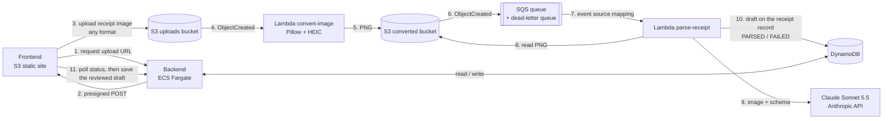

# my-finance

Personal expense tracker with three services:

- **backend** — FastAPI + DynamoDB (`backend/`)
- **lambdas** — the receipt pipeline on AWS: `convert_image` (any image format to PNG) and `parse_receipt` (Claude extracts the data) (`lambdas/`)
- **receipt_parser** — legacy local-only FastAPI service with a Qwen model, used by the synchronous endpoints of the local docker stack (`receipt_parser/`)
- **frontend** — Vite/React SPA, served by nginx locally and from S3 on AWS (`frontend/`)

## Architecture (AWS target)



Upload flow:

1. The frontend asks the backend for an upload URL; the backend creates the
   receipt record (`UPLOADING`) and returns a time-limited **presigned S3 POST**.
   The image goes straight from the browser to S3 and never passes through the
   backend.
2. S3 invokes the **convert-image Lambda**. A PNG that is already usable (valid,
   at most 4 MB, longest side at most 2000 px, not rotated) is copied unchanged;
   any other image is converted to a PNG (EXIF rotation applied, longest side at
   most 2000 px). Either way it lands with the same key layout in a second
   bucket. Failed conversions are kept in a failures queue.
3. The converted bucket sends `ObjectCreated` to **SQS**. The queue gives
   retries, a dead-letter queue after 3 receives, and (with
   `maximum_concurrency`) a cap on parallel model calls.
4. The **parse-receipt Lambda** reads the PNG, asks Claude for store, date,
   items and total (structured output), and stores the result as a draft on the
   receipt record (`PARSED`; `FAILED` after the last attempt, or at once when
   neither items nor a total can be read).
5. The frontend polls the backend, shows the editable draft, and only saving it
   creates the expense.

Why two buckets: S3 allows one notification configuration per bucket, and
writing the PNG to another bucket avoids a Lambda triggering itself. Why
Lambda: no always-on container, and no NAT gateway or VPC needed to reach the
Anthropic API. Details in
[ADR-013](docs/architecture/ADRs/ADR-013-lambda-receipt-pipeline-with-png-conversion.md),
the model choice in
[ADR-012](docs/architecture/ADRs/ADR-012-claude-sonnet-for-receipt-parsing.md),
steps in [plan 03](docs/implementation/03-lambda-receipt-pipeline.md).

| Component | Status |
| --------- | ------ |
| Frontend on S3, backend on ECS Fargate, DynamoDB | Deployed (see [ADR-007](docs/architecture/ADRs/ADR-007-backend-on-ecs-fargate-no-alb.md)) |
| Presigned upload endpoint, S3 uploads bucket + CORS, upload page | Implemented in code and Terraform, not verified on AWS yet |
| convert-image Lambda, converted bucket, S3 → SQS notification, DLQ | Deployed (no DLQ alarm yet) |
| parse-receipt Lambda with Claude Sonnet 5.5 (Anthropic API) | Deployed and tested with a real receipt. Still to do: the accuracy evaluation on a proper set of receipts |
| Authentication (Cognito login page, JWT-verified API, per-user data) | Implemented, not deployed yet (see [ADR-009](docs/architecture/ADRs/ADR-009-cognito-authentication.md)) |
| HTTPS / load balancer | Planned |

The earlier Fargate parser worker ([ADR-010](docs/architecture/ADRs/ADR-010-async-receipt-upload-pipeline.md))
was replaced by the two Lambdas.

Progress and open work are tracked in [TODO.md](TODO.md); design decisions in
[docs/architecture/ADRs](docs/architecture/ADRs).

## Development setup

Requires [uv](https://docs.astral.sh/uv/).

```bash
# Backend dependencies (including dev tools: pytest, moto, ruff)
cd backend && uv sync --extra dev && cd ..

# Lambda functions (receipt pipeline): same tools, separate environment
cd lambdas && uv sync --extra dev && uv run pytest && cd ..

# Git hooks: runs ruff (lint + format) on backend/*.py and lambdas/*.py before each commit
uv tool install pre-commit
pre-commit install
```

`pre-commit install` registers `.git/hooks/pre-commit` for this clone only, so
repeat it on every fresh clone. The hook calls `scripts/ruff-fix.sh`; run
`scripts/ruff-fix.sh` (or `pre-commit run --all-files`) to check the whole
backend manually. If the hook modifies files, the commit is aborted: re-stage
and commit again.

## Deployment (`deploy.sh`)

`deploy.sh` is the single entry point for building and running the stack. It
wraps `docker compose` and loads environment variables from `envs/<env>.env`.

### Prerequisites

- Docker with Compose v2 (`docker compose`) — v1 (`docker-compose`) also works.
- The Qwen model weights present at
  `receipt_parser/app/data/models/Qwen3.5-2B/` (mounted read-only into the
  `receipt_parser` container; see [docker-compose.yml](docker-compose.yml)).

### Usage

```bash
./deploy.sh --env <local|aws|prod> [--down | --logs | --destroy]
```

| Flag        | Effect                                                      |
| ----------- | ----------------------------------------------------------- |
| `--env`     | **Required.** `local` (docker compose) or `aws`/`prod` (same thing). |
| `--down`    | `local`: stop and remove the containers. `aws`: destroy the frontend and the backend service (see below). |
| `--logs`    | `local` only: follow logs from all containers.              |
| `--destroy` | `aws` only: same as `--down`.                                |
| `-h`, `--help` | Print usage.                                             |

Default action (no flag) is `up --build -d`.

### Local environment

```bash
# Build images and start the stack in the background
./deploy.sh --env local

# Follow logs
./deploy.sh --env local --logs

# Tear it down
./deploy.sh --env local --down
```

On a successful `up`, the script prints the URLs it just brought up, e.g.:

```
Local stack is up:
  frontend        http://localhost:8501
  backend API     http://localhost:8000
  receipt parser  http://localhost:8001
```

Host ports come from [envs/local.env](envs/local.env) — change
`FRONTEND_PORT` / `BACKEND_PORT` / `RECEIPT_PARSER_PORT` there if you need
different values.

### Environment files (`envs/`)

`deploy.sh` reads variables from `envs/<env>.env` and uses them in two ways:

1. **Compose variable substitution** — passed via `docker compose --env-file`,
   so `${BACKEND_PORT}` etc. in [docker-compose.yml](docker-compose.yml)
   resolve at compose-time (host port bindings, build args like
   `VITE_BACKEND_URL`).
2. **Container runtime environment** — each service in the compose file
   references the same file via `env_file:`, so the vars are also available
   inside the running containers (e.g. `DATABASE_URL`, `RECEIPT_PARSER_URL`
   for the backend).

`BACKEND_PORT`, `RECEIPT_PARSER_PORT`, and `FRONTEND_PORT` are required —
`deploy.sh` exits with an error if any of them is missing from the env file.

### Authentication (Cognito)

AWS deploys create a Cognito user pool; self-sign-up is off, so create your user
once after `./deploy.sh --env aws` (`terraform output` shows the pool id):

```bash
POOL=$(terraform -chdir=terraform output -raw cognito_user_pool_id)
aws cognito-idp admin-create-user --user-pool-id "$POOL" --username you@example.com \
    --user-attributes Name=email,Value=you@example.com Name=email_verified,Value=true \
    --message-action SUPPRESS
aws cognito-idp admin-set-user-password --user-pool-id "$POOL" --username you@example.com \
    --password '<12+ chars, upper, lower, digit>' --permanent
```

The local docker stack runs without login (`AUTH_DISABLED=true` in
[envs/local.env](envs/local.env); the backend acts as the user `local`).

Two env files ship with the repo:

- [envs/local.env](envs/local.env) — everything on localhost / on-disk paths.
- [envs/aws.env](envs/aws.env) — shape only, for reference. `deploy.sh` does
  not read it; AWS values come from Terraform outputs.

### `--env prod` / `--env aws`

`./deploy.sh --env aws` deploys to AWS (add `--down` to tear down). Flow
(see the header of [deploy.sh](deploy.sh)):

1. Create the ECR repositories (Terraform `-target=module.ecr`).
2. Build the backend image and the two Lambda images (`lambdas/convert_image`,
   `lambdas/parse_receipt`; `linux/arm64`, `--provenance=false`) and push them
   to ECR.
3. `terraform apply` for the S3 buckets (frontend, uploads, converted), SQS
   queue + DLQ, the two Lambdas, DynamoDB, Cognito, IAM and ECS.
4. `aws ecs update-service --force-new-deployment` for the backend, waiting
   until it is stable; `aws lambda update-function-code` for both Lambdas
   (the tag is always `:latest`), waiting until they are updated.
5. Look up the backend task's public IP, build the frontend against it (plus
   the Cognito pool and client IDs) and `aws s3 sync` it to the bucket.

**One manual step: the Claude API key.** Terraform creates the parse-receipt
Lambda with the placeholder `set-me-in-the-lambda-console`. After the first
deploy, open the AWS console, Lambda, `finance-prod-...-parse-receipt`,
Configuration, Environment variables, and set `ANTHROPIC_API_KEY` to your
Anthropic Console key. Terraform ignores later changes to that variable, so
redeploys keep it. `deploy.sh` prints a warning while the placeholder is still
there. Also set a spend limit in the Anthropic console. Model and effort are the
Terraform variables `claude_model` and `claude_effort`.

The backend port is open to the internet over plain HTTP; the IP allow-list
was dropped ([ADR-011](docs/architecture/ADRs/ADR-011-drop-backend-ip-allow-list.md))
and protection is Cognito JWT auth. There is no load balancer or TLS yet, so
the task IP changes on every restart. See
[ADR-007](docs/architecture/ADRs/ADR-007-backend-on-ecs-fargate-no-alb.md).
`--down` removes the frontend bucket and the backend ECS service; ECR, the
Lambdas, DynamoDB data, Cognito, the receipt buckets and SQS stay until a full
`terraform destroy` (they cost nothing while idle).

**Cost:** the running Fargate backend task bills by the hour; set
`backend_desired_count=0` to pause it without destroying anything. The Lambdas,
SQS and S3 are near-free at this scale (free tier); the per-receipt cost is the
Claude API call (`parse_max_concurrency` caps parallel calls).
