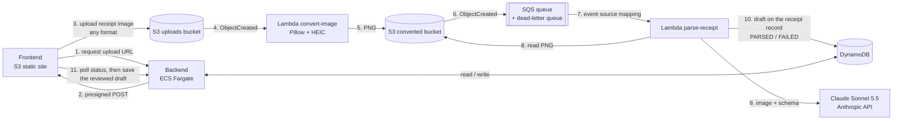
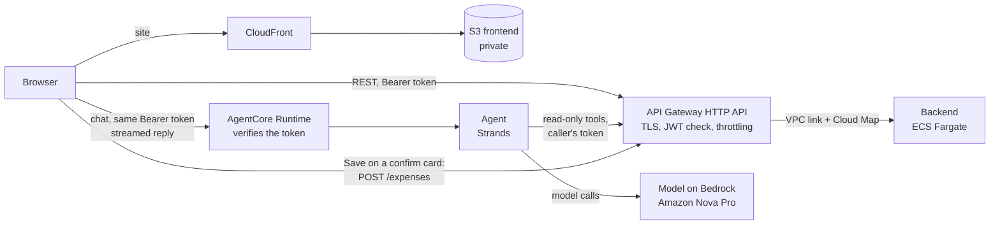

# my-finance

Personal expense tracker with three services:

- **backend** — FastAPI + DynamoDB (`backend/`)
- **lambdas** — the receipt pipeline on AWS: `convert_image` (any image format to PNG) and `parse_receipt` (Claude extracts the data) (`lambdas/`)
- **receipt_parser** — legacy local-only FastAPI service with a Qwen model, used by the synchronous endpoints of the local docker stack (`receipt_parser/`)
- **frontend** — Vite/React SPA, served by nginx locally and from S3 behind CloudFront on AWS (`frontend/`)
- **agent** — chat agent on Amazon Bedrock AgentCore Runtime: a second interface (the Chat tab) over the same REST API (`agent/`, [ADR-014](docs/architecture/ADRs/ADR-014-chat-agent-facade-on-agentcore.md))

## Architecture (AWS target)



Upload flow:

1. The frontend asks the backend for an upload URL; the backend creates the
   receipt record (`UPLOADING`) and returns a time-limited **presigned S3 POST**.
   The image goes straight from the browser to S3 and never passes through the
   backend.
2. S3 invokes the **convert-image Lambda**. A PNG that is already usable (valid,
   at most 4 MB, longest side at most 2000 px, not rotated) is copied unchanged;
   any other image is converted to a PNG (EXIF rotation applied, longest side at
   most 2000 px). Either way it lands with the same key layout in a second
   bucket. Failed conversions are kept in a failures queue.
3. The converted bucket sends `ObjectCreated` to **SQS**. The queue gives
   retries, a dead-letter queue after 3 receives, and (with
   `maximum_concurrency`) a cap on parallel model calls.
4. The **parse-receipt Lambda** reads the PNG, asks Claude for store, date,
   items and total (structured output), and stores the result as a draft on the
   receipt record (`PARSED`; `FAILED` after the last attempt, or at once when
   neither items nor a total can be read).
5. The frontend polls the backend, shows the editable draft, and only saving it
   creates the expense.

Why two buckets: S3 allows one notification configuration per bucket, and
writing the PNG to another bucket avoids a Lambda triggering itself. Why
Lambda: no always-on container, and no NAT gateway or VPC needed to reach the
Anthropic API. Details in
[ADR-013](docs/architecture/ADRs/ADR-013-lambda-receipt-pipeline-with-png-conversion.md),
the model choice in
[ADR-012](docs/architecture/ADRs/ADR-012-claude-sonnet-for-receipt-parsing.md),
steps in [plan 03](docs/implementation/03-lambda-receipt-pipeline.md).

### Chat agent and HTTPS front door (ADR-014)



- The chat is a **facade**: the agent's tools call the same REST API as the pages, with the
  caller's own token, so the backend still decides whose data a request touches.
- The agent **cannot write**. It proposes an expense; the chat shows an editable card and only
  the user's Save creates it (with an idempotency key, so a double click creates one expense).
- The backend task is reached only through the HTTP API (stable HTTPS URL, no load balancer);
  its security group has no public inbound rule.
- How to work on the agent, its limits and its eval set: [agent/README.md](agent/README.md).

| Component | Status |
| --------- | ------ |
| Frontend on S3, backend on ECS Fargate, DynamoDB | Deployed (see [ADR-007](docs/architecture/ADRs/ADR-007-backend-on-ecs-fargate-no-alb.md)) |
| Presigned upload endpoint, S3 uploads bucket + CORS, upload page | Implemented in code and Terraform, not verified on AWS yet |
| convert-image Lambda, converted bucket, S3 → SQS notification, DLQ | Deployed (no DLQ alarm yet) |
| parse-receipt Lambda with Claude Sonnet 5.5 (Anthropic API) | Deployed and tested with a real receipt. Still to do: the accuracy evaluation on a proper set of receipts |
| Authentication (Cognito login page, JWT-verified API, per-user data) | Implemented, not deployed yet (see [ADR-009](docs/architecture/ADRs/ADR-009-cognito-authentication.md)) |
| HTTPS: API Gateway HTTP API in front of the backend, CloudFront in front of a private frontend bucket | Implemented in code and Terraform, not deployed yet (see [ADR-014](docs/architecture/ADRs/ADR-014-chat-agent-facade-on-agentcore.md)) |
| Chat agent (AgentCore Runtime, Bedrock, Chat tab), summary endpoint, typed items, idempotent create | Implemented with tests, not deployed yet; the eval set has not been run against the model ([plan 04](docs/implementation/04-chat-agent-facade.md)) |

The earlier Fargate parser worker ([ADR-010](docs/architecture/ADRs/ADR-010-async-receipt-upload-pipeline.md))
was replaced by the two Lambdas.

Progress and open work are tracked in [TODO.md](TODO.md); design decisions in
[docs/architecture/ADRs](docs/architecture/ADRs).

## Development setup

Requires [uv](https://docs.astral.sh/uv/).

```bash
# Backend dependencies (including dev tools: pytest, moto, ruff)
cd backend && uv sync --extra dev && cd ..

# Lambda functions (receipt pipeline): same tools, separate environment
cd lambdas && uv sync --extra dev && uv run pytest && cd ..

# Chat agent: same tools, separate environment (details in agent/README.md)
cd agent && uv sync --extra dev && uv run pytest && cd ..

# Git hooks: runs ruff (lint + format) on backend, lambdas and agent *.py before each commit
uv tool install pre-commit
pre-commit install
```

`pre-commit install` registers `.git/hooks/pre-commit` for this clone only, so
repeat it on every fresh clone. The hook calls `scripts/ruff-fix.sh`; run
`scripts/ruff-fix.sh` (or `pre-commit run --all-files`) to check the whole
backend manually. If the hook modifies files, the commit is aborted: re-stage
and commit again.

## Deployment (`deploy.sh`)

`deploy.sh` is the single entry point for building and running the stack. It
wraps `docker compose` and loads environment variables from `envs/<env>.env`.

### Prerequisites

- Docker with Compose v2 (`docker compose`) — v1 (`docker-compose`) also works.
- The Qwen model weights present at
  `receipt_parser/app/data/models/Qwen3.5-2B/` (mounted read-only into the
  `receipt_parser` container; see [docker-compose.yml](docker-compose.yml)).

### Usage

```bash
./deploy.sh --env <local|aws|prod> [--down | --logs | --destroy]
```

| Flag        | Effect                                                      |
| ----------- | ----------------------------------------------------------- |
| `--env`     | **Required.** `local` (docker compose) or `aws`/`prod` (same thing). |
| `--down`    | `local`: stop and remove the containers. `aws`: destroy the frontend and the backend service (see below). |
| `--logs`    | `local` only: follow logs from all containers.              |
| `--destroy` | `aws` only: same as `--down`.                                |
| `-h`, `--help` | Print usage.                                             |

Default action (no flag) is `up --build -d`.

### Local environment

```bash
# Build images and start the stack in the background
./deploy.sh --env local

# Follow logs
./deploy.sh --env local --logs

# Tear it down
./deploy.sh --env local --down
```

On a successful `up`, the script prints the URLs it just brought up, e.g.:

```
Local stack is up:
  frontend        http://localhost:8501
  backend API     http://localhost:8000
  receipt parser  http://localhost:8001
```

Host ports come from [envs/local.env](envs/local.env) — change
`FRONTEND_PORT` / `BACKEND_PORT` / `RECEIPT_PARSER_PORT` there if you need
different values.

### Environment files (`envs/`)

`deploy.sh` reads variables from `envs/<env>.env` and uses them in two ways:

1. **Compose variable substitution** — passed via `docker compose --env-file`,
   so `${BACKEND_PORT}` etc. in [docker-compose.yml](docker-compose.yml)
   resolve at compose-time (host port bindings, build args like
   `VITE_BACKEND_URL`).
2. **Container runtime environment** — each service in the compose file
   references the same file via `env_file:`, so the vars are also available
   inside the running containers (e.g. `DATABASE_URL`, `RECEIPT_PARSER_URL`
   for the backend).

`BACKEND_PORT`, `RECEIPT_PARSER_PORT`, and `FRONTEND_PORT` are required —
`deploy.sh` exits with an error if any of them is missing from the env file.

### Authentication (Cognito)

AWS deploys create a Cognito user pool; self-sign-up is off, so create your user
once after `./deploy.sh --env aws` (`terraform output` shows the pool id):

```bash
POOL=$(terraform -chdir=terraform output -raw cognito_user_pool_id)
aws cognito-idp admin-create-user --user-pool-id "$POOL" --username you@example.com \
    --user-attributes Name=email,Value=you@example.com Name=email_verified,Value=true \
    --message-action SUPPRESS
aws cognito-idp admin-set-user-password --user-pool-id "$POOL" --username you@example.com \
    --password '<12+ chars, upper, lower, digit>' --permanent
```

The local docker stack runs without login (`AUTH_DISABLED=true` in
[envs/local.env](envs/local.env); the backend acts as the user `local`).

Two env files ship with the repo:

- [envs/local.env](envs/local.env) — everything on localhost / on-disk paths.
- [envs/aws.env](envs/aws.env) — shape only, for reference. `deploy.sh` does
  not read it; AWS values come from Terraform outputs.

### `--env prod` / `--env aws`

`./deploy.sh --env aws` deploys to AWS (add `--down` to tear down). Flow
(see the header of [deploy.sh](deploy.sh)):

1. Create the ECR repositories (Terraform `-target=module.ecr`).
2. Build the backend image, the two Lambda images (`lambdas/convert_image`,
   `lambdas/parse_receipt`) and the chat agent image (`agent/`), all `linux/arm64` with
   `--provenance=false`, and push them to ECR. The agent image gets a unique tag per build.
3. `terraform apply` for the S3 buckets (frontend, uploads, converted), CloudFront, SQS
   queue + DLQ, the two Lambdas, DynamoDB, Cognito, IAM, ECS with Cloud Map, the API Gateway
   HTTP API and the AgentCore runtime (the agent image tag is passed in). The first run
   creates a CloudFront distribution, which takes 5 to 15 minutes.
4. `aws ecs update-service --force-new-deployment` for the backend, waiting
   until it is stable; `aws lambda update-function-code` for both Lambdas
   (the tag is always `:latest`), waiting until they are updated.
5. Build the frontend against the API Gateway URL and the agent URL (plus the Cognito pool
   and client IDs), `aws s3 sync` it to the bucket and invalidate the CloudFront cache.

**Chat model.** The agent calls a model on Amazon Bedrock with its IAM role (no API key).
The model is the Terraform variable `chat_model_id`, default `eu.amazon.nova-pro-v1:0`
(Amazon Nova Pro, EU inference profile): it needs no third-party agreement and passes the
agent's eval set. Claude models (`eu.anthropic.claude-sonnet-5-5`) need the Anthropic use-case
form submitted in the Bedrock console first; until then every call fails with
`AccessDeniedException`. Run the evals before switching models ([agent/README.md](agent/README.md)).
Set `budget_alert_email` to get an AWS Budgets alert at 80% of `monthly_budget_usd`.

**One manual step: the Claude API key.** Terraform creates the parse-receipt
Lambda with the placeholder `set-me-in-the-lambda-console`. After the first
deploy, open the AWS console, Lambda, `finance-prod-...-parse-receipt`,
Configuration, Environment variables, and set `ANTHROPIC_API_KEY` to your
Anthropic Console key. Terraform ignores later changes to that variable, so
redeploys keep it. `deploy.sh` prints a warning while the placeholder is still
there. Also set a spend limit in the Anthropic console. Model and effort are the
Terraform variables `claude_model` and `claude_effort`.

The backend is reached only through the API Gateway HTTP API: HTTPS, the Cognito token
checked at the gateway and again in the backend, and throttling. The task's port is closed to
the internet, and its changing IP no longer matters because API Gateway finds the task through
Cloud Map ([ADR-014](docs/architecture/ADRs/ADR-014-chat-agent-facade-on-agentcore.md), which
amends [ADR-007](docs/architecture/ADRs/ADR-007-backend-on-ecs-fargate-no-alb.md) and
[ADR-011](docs/architecture/ADRs/ADR-011-drop-backend-ip-allow-list.md)).
`--down` removes the frontend bucket and the backend ECS service together with what depends
on them (CloudFront, the HTTP API, Cloud Map, the chat agent runtime); ECR, the Lambdas,
DynamoDB data, Cognito, the receipt buckets and SQS stay until a full `terraform destroy`
(they cost nothing while idle).

### Stopping the spend

What costs money, most to least likely to surprise you, and the command that stops each one.
Run them from the repository root. Everything comes back with `./deploy.sh --env aws`.

| What | Why it costs | Stop it |
|---|---|---|
| Chat agent | Every chat message is several Bedrock model calls, plus AgentCore CPU and memory while a session is open. It is the only thing that scales with how much the chat is used. | `terraform -chdir=terraform destroy -target=module.chat_agent` |
| Receipt parsing | Every uploaded receipt is one Claude API call (Anthropic bill, not AWS). | `aws lambda update-event-source-mapping --no-enabled --uuid "$(aws lambda list-event-source-mappings --function-name "$(terraform -chdir=terraform output -raw parse_receipt_function_name)" --query 'EventSourceMappings[0].UUID' --output text)"` |
| Backend task | The only hourly charge: one Fargate task, running or not used. | `aws ecs update-service --cluster "$(terraform -chdir=terraform output -raw ecs_cluster_name)" --service "$(terraform -chdir=terraform output -raw ecs_backend_service_name)" --desired-count 0` |
| Frontend, API, backend, chat together | CloudFront, the HTTP API and Cloud Map (about $0.50 per month) go with them. | `./deploy.sh --env aws --down` |
| Everything, including data | Removes DynamoDB data, Cognito users, receipts, ECR images. Cannot be undone. | `terraform -chdir=terraform destroy -var force_destroy_buckets=true` |

Notes:
- Destroying `module.chat_agent` removes the runtime and its IAM role only. The Chat tab then
  shows an error with a link to the dashboard; every other page keeps working.
- The receipt command switches off the link between the SQS queue and the parse Lambda.
  Uploads then wait in the queue untouched (for up to 4 days) and are parsed when you run the
  same command with `--enabled`. Do not set the Lambda's concurrency to 0 instead: throttled
  deliveries still count as receive attempts, so waiting receipts would end up in the
  dead-letter queue after three tries without ever being marked `FAILED`.
- The two `aws` commands change settings outside Terraform. The next `terraform apply` (so the
  next `./deploy.sh --env aws`) switches receipt parsing back on and puts the backend back to
  `backend_desired_count`. To keep the
  backend stopped across deploys, set `backend_desired_count = 0` in `terraform/terraform.tfvars`.
- Limits that are always on: API Gateway throttling (10 requests per second), and in the agent
  8 tool calls per message, 30 messages per conversation and a 2,000-token answer cap.
- A hard stop for an emergency is the chat agent line: after it, nothing can call a model for chat.

**Cost:** the running Fargate backend task bills by the hour; set
`backend_desired_count=0` to pause it without destroying anything. The Lambdas,
SQS and S3 are near-free at this scale (free tier); the per-receipt cost is the
Claude API call (`parse_max_concurrency` caps parallel calls). API Gateway, CloudFront and
AgentCore Runtime bill per use; the Cloud Map private DNS namespace is about $0.50 per month.
Each chat message costs several Bedrock model calls (capped per message and per session, see
[agent/README.md](agent/README.md)); the agent logs tokens and an estimated cost per turn.
