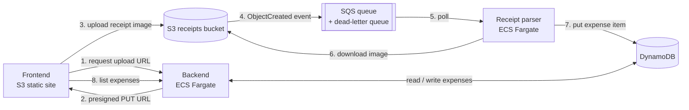

# my-finance

Personal expense tracker with three services:

- **backend** — FastAPI + DynamoDB (`backend/`)
- **receipt_parser** — Python service with a local Qwen model that extracts data from receipt images (`receipt_parser/`)
- **frontend** — Vite/React SPA, served by nginx locally and from S3 on AWS (`frontend/`)

## Architecture (AWS target)



Upload flow:

1. The frontend asks the backend for an upload URL.
2. The backend returns a time-limited **presigned S3 URL**. The image goes
   straight from the browser to S3 and never passes through the backend.
3. S3 emits an `ObjectCreated` event notification to an **SQS** queue.
4. The receipt parser (ECS service) long-polls the queue, downloads the image,
   runs the model, and writes a new expense item to **DynamoDB**.
5. Failed messages are retried and then moved to a dead-letter queue.
6. The frontend sees the new expense through the regular backend API.

| Component | Status |
| --------- | ------ |
| Frontend on S3, backend on ECS Fargate, DynamoDB | Deployed (see [ADR-007](docs/architecture/ADRs/ADR-007-backend-on-ecs-fargate-no-alb.md)) |
| Presigned upload endpoint, S3 receipts bucket + CORS | Planned |
| S3 → SQS event notification, DLQ | Planned |
| Receipt parser as SQS consumer on ECS | Planned (today it is a FastAPI service run locally) |
| Authentication, load balancer | Planned |

Progress and open work are tracked in [TODO.md](TODO.md); design decisions in
[docs/architecture/ADRs](docs/architecture/ADRs).

## Development setup

Requires [uv](https://docs.astral.sh/uv/).

```bash
# Backend dependencies (including dev tools: pytest, moto, ruff)
cd backend && uv sync --extra dev && cd ..

# Git hooks: runs ruff (lint + format) on backend/*.py before each commit
uv tool install pre-commit
pre-commit install
```

`pre-commit install` registers `.git/hooks/pre-commit` for this clone only, so
repeat it on every fresh clone. The hook calls `scripts/ruff-fix.sh`; run
`scripts/ruff-fix.sh` (or `pre-commit run --all-files`) to check the whole
backend manually. If the hook modifies files, the commit is aborted: re-stage
and commit again.

## Deployment (`deploy.sh`)

`deploy.sh` is the single entry point for building and running the stack. It
wraps `docker compose` and loads environment variables from `envs/<env>.env`.

### Prerequisites

- Docker with Compose v2 (`docker compose`) — v1 (`docker-compose`) also works.
- The Qwen model weights present at
  `receipt_parser/app/data/models/Qwen3.5-2B/` (mounted read-only into the
  `receipt_parser` container; see [docker-compose.yml](docker-compose.yml)).

### Usage

```bash
./deploy.sh --env <local|prod> [--down | --logs]
```

| Flag        | Effect                                                      |
| ----------- | ----------------------------------------------------------- |
| `--env`     | **Required.** Target environment. Only `local` is implemented today; `prod`/`aws` exits with a "not implemented" message. |
| `--down`    | Stop and remove the local containers.                       |
| `--logs`    | Follow logs from all local containers.                      |
| `-h`, `--help` | Print usage.                                             |

Default action (no flag) is `up --build -d`.

### Local environment

```bash
# Build images and start the stack in the background
./deploy.sh --env local

# Follow logs
./deploy.sh --env local --logs

# Tear it down
./deploy.sh --env local --down
```

On a successful `up`, the script prints the URLs it just brought up, e.g.:

```
Local stack is up:
  frontend        http://localhost:8501
  backend API     http://localhost:8000
  receipt parser  http://localhost:8001
```

Host ports come from [envs/local.env](envs/local.env) — change
`FRONTEND_PORT` / `BACKEND_PORT` / `RECEIPT_PARSER_PORT` there if you need
different values.

### Environment files (`envs/`)

`deploy.sh` reads variables from `envs/<env>.env` and uses them in two ways:

1. **Compose variable substitution** — passed via `docker compose --env-file`,
   so `${BACKEND_PORT}` etc. in [docker-compose.yml](docker-compose.yml)
   resolve at compose-time (host port bindings, build args like
   `VITE_BACKEND_URL`).
2. **Container runtime environment** — each service in the compose file
   references the same file via `env_file:`, so the vars are also available
   inside the running containers (e.g. `DATABASE_URL`, `RECEIPT_PARSER_URL`
   for the backend).

`BACKEND_PORT`, `RECEIPT_PARSER_PORT`, and `FRONTEND_PORT` are required —
`deploy.sh` exits with an error if any of them is missing from the env file.

Two env files ship with the repo:

- [envs/local.env](envs/local.env) — everything on localhost / on-disk paths.
- [envs/aws.env](envs/aws.env) — shape only, populated from Terraform outputs.
  Not wired into `deploy.sh` yet (see below).

### `--env prod` / `--env aws`

`./deploy.sh --env aws` deploys to AWS (add `--down` to tear down). Flow
(see the header of [deploy.sh](deploy.sh)):

1. Create the ECR repository (Terraform `-target=module.ecr`).
2. Build the backend image (`linux/arm64`) and push it to ECR.
3. `terraform apply` for the S3 bucket, DynamoDB, IAM and ECS.
4. `aws ecs update-service --force-new-deployment`, then wait until the
   service is stable.
5. Look up the backend task's public IP, build the frontend against it and
   `aws s3 sync` it to the bucket.

The backend port is open only to your current public IP (no auth yet), and
there is no load balancer, so the task IP changes on every restart. See
[ADR-007](docs/architecture/ADRs/ADR-007-backend-on-ecs-fargate-no-alb.md).
`--down` removes the frontend bucket and ECS service; ECR and DynamoDB data
stay until a full `terraform destroy`. The receipt parser deploy is not
implemented yet.

**Cost:** a running Fargate task bills by the hour. Set
`backend_desired_count=0` to pause it without destroying anything.
