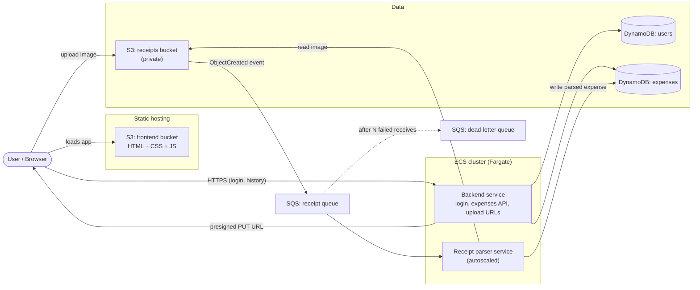

# Architecture overview

Current target architecture for the my-finance application (Stage A, no agents yet).
See [development-phases.md](development-phases.md) for the staged plan.

## Diagram

## Components

### Frontend (S3 static hosting)
Plain HTML, CSS and JavaScript served from an S3 bucket. It contains the login
screen, the expense history, month filtering and the visualizations. It holds no
secrets and talks only to the backend service over HTTPS. Changing the UI means
uploading new files to the bucket; nothing needs to be rebuilt or restarted.

### Backend service (ECS Fargate)
The only service the UI talks to. It has three responsibilities:

- **Authentication.** Registers and logs in users by checking the password against
  the stored hash, then returns a signed token. Every other endpoint requires that
  token.
- **Expense history.** Returns the expenses of the authenticated user, with
  filtering (for example by month).
- **Upload URLs.** Returns a short-lived presigned S3 URL so the browser uploads
  a receipt image directly to S3. The image never passes through the backend.
  Images are write-only from the UI's point of view: the backend issues upload
  URLs only, never download URLs, and the UI never displays the original image.
  It shows only the parsed data stored in DynamoDB.

The user ID always comes from the verified token, never from the request body or
URL. This is the main authorization rule: a user can only read their own data.
It runs a small fixed number of tasks behind a load balancer and does not need
autoscaling.

### Receipt parser service (ECS Fargate)
A worker, not an HTTP service. It polls the SQS queue, downloads the receipt image
from S3, parses it with the custom parsing solution, and writes the resulting
expense record to DynamoDB under the right user. It is the only part of the
system that scales (see below). Processing must be idempotent because SQS
delivers messages at least once.

### DynamoDB
- **users**: one item per user, holding the user ID, login name and password hash
  (never the plain password).
- **expenses**: one item per expense, partitioned by user ID and sorted by date, so
  fetching a user's history (or one month of it) is a single query on one
  partition.

### S3 receipts bucket
Private bucket for receipt images. Objects are stored under a per-user prefix,
`receipts/<user_id>/<receipt_id>`, so the parser can tell whose receipt it is from
the key alone. Uploads happen only through presigned URLs issued by the backend.
Only the parser reads from this bucket; nothing user-facing does.

### SQS queue and dead-letter queue
S3 sends an `ObjectCreated` notification straight to the queue when an upload
finishes. The queue decouples uploading from parsing: uploads succeed even if the
parser is slow or down, and bursts are absorbed by the queue. Messages that fail
repeatedly move to the dead-letter queue, where they can be inspected and
retried, and an alarm on its depth flags parsing problems.

## Receipt flow

1. The UI asks the backend for an upload URL, authenticated with the user's token.
2. The backend returns a presigned S3 URL for `receipts/<user_id>/<receipt_id>`.
3. The browser uploads the image directly to the receipts bucket.
4. S3 publishes an `ObjectCreated` event to the SQS queue.
5. A parser task receives the message, reads the image, and parses it.
6. The parser writes the expense to the `expenses` table for that user.
7. The UI shows the new expense the next time it fetches history.

## Scalability

Only the parser scales. Its ECS service uses target-tracking autoscaling on
queue depth (visible messages per running task), scaling out when receipts pile
up and back in when the queue is empty. The backend stays at a fixed small task
count, and S3, SQS and DynamoDB scale on their own.

## Security notes

- Passwords are stored only as salted hashes (argon2 or bcrypt).
- The receipts bucket blocks all public access. The backend's role can only sign
  uploads (`s3:PutObject`), not reads, so a compromised backend or token cannot
  fetch stored images.
- Each ECS service has its own IAM task role with least privilege: the backend can
  access the tables and sign S3 uploads; the parser can receive from SQS, read
  from S3 and write to the expenses table.
- The browser may only call the backend; CORS on the backend allows only the
  frontend origin.

## Open points

- Frontend hosting: plain S3 website hosting serves HTTP only. CloudFront in
  front of a private bucket would add HTTPS and allow same-origin `/api` routing.
- Token format and lifetime for the login feature (for example JWT with expiry,
  and whether to add refresh tokens).
- Compute for the parser: CPU-only Fargate versus EC2-backed capacity, depending
  on the size of the parsing model.
- Later stages add an MCP server and a chat service on ECS; they are intentionally
  not part of this document yet.
